## 🏗️ Software Architecture Series
[Part 1: Procedural Baseline](https://github.com/Sharaf-Ahmed-Dev/arch-1-procedural) | [Part 2: OOP Migration](https://github.com/Sharaf-Ahmed-Dev/arch-2-oop) | **Part 3: SOLID Principles (Current Repo)** | [Part 4: Design Patterns](https://github.com/Sharaf-Ahmed-Dev/arch-4-patterns)

---

### Software Architecture Series - Part 3: SOLID Principles Refactoring

## 📌 Overview
This repository contains **Part 3 of a 4-part software architecture series**. In this phase, the object-oriented foundation built in Part 2 is refactored into a highly maintainable, extensible enterprise structure adhering strictly to the **SOLID Principles**.

By introducing abstraction layers (`Calculable`, `DiscountStrategy`, `Printable`, `NotificationService`), polymorphic domain models (`PrintedBook`, `EBook`), and dependency inversion, the application successfully decouples presentation, business logic, calculation engines, and notification handling.

---

## 🏛️ SOLID Principles Implementation Breakdown

| Principle | Refactoring Strategy in Part 3 | Key Java Components |
| :--- | :--- | :--- |
| **S** - Single Responsibility | Separated presentation and calculations from entities. Domain classes no longer control output formatting or total pricing. | `BillCalculator`, `ConsoleInvoicePrinter`, `ConsoleNotification` |
| **O** - Open/Closed | Extended system behavior (discounts, formats) by implementing interfaces and subclassing without modifying existing code. | `DiscountStrategy` (`NoDiscount`, `MemberDiscount`, `SeasonalDiscount`), `Book` (`PrintedBook`, `EBook`) |
| **L** - Liskov Substitution | Subclasses (`PrintedBook`, `EBook`) cleanly substitute the abstract `Book` superclass across inventory collections without side effects. | `Book` superclass, `PrintedBook`, `EBook` |
| **I** - Interface Segregation | Created lightweight, focused interfaces instead of monolithic bloated contracts. Clients only depend on methods they use. | `Calculable`, `DiscountStrategy`, `Printable`, `NotificationService` |
| **D** - Dependency Inversion | High-level business logic (`Purchase`, `Main`) depends on abstractions rather than concrete execution types. | Injection of `Calculable`, `DiscountStrategy`, `Printable`, and `NotificationService` |

---

## 📐 UML Class Diagram

```mermaid
classDiagram
    class Book {
        <<abstract>>
        -String title
        -String author
        -double price
        +Book(title : String, author : String, price : double)
        +getTitle() String
        +setTitle(title : String) void
        +getAuthor() String
        +setAuthor(author : String) void
        +getPrice() double
        +setPrice(price : double) void
        +getFormatDetails()* String
        +displayBook(index : int) void
    }

    class PrintedBook {
        -double weightInKg
        +PrintedBook(title : String, author : String, price : double, weightInKg : double)
        +getWeightInKg() double
        +getFormatDetails() String
    }

    class EBook {
        -double fileSizeMb
        +EBook(title : String, author : String, price : double, fileSizeMb : double)
        +getFileSizeMb() double
        +getFormatDetails() String
    }

    class Customer {
        -int customerId
        -String name
        +Customer(customerId : int, name : String)
        +getCustomerId() int
        +getName() String
    }

    class BookstoreManager {
        -List~Book~ inventory
        +BookstoreManager()
        -initializeInventory() void
        +addBook(book : Book) void
        +getBookByIndex(index : int) Book
        +getInventorySize() int
        +displayInventory() void
    }

    class Purchase {
        -int purchaseId
        -Customer customer
        -List~Book~ purchasedBooks
        +Purchase(purchaseId : int, customer : Customer)
        +addBook(book : Book) void
        +checkout(calculator : Calculable, discountStrategy : DiscountStrategy) Invoice
        +getPurchasedBooks() List~Book~
        +getPurchaseId() int
    }

    class Invoice {
        -int invoiceId
        -Customer customer
        -List~Book~ books
        -double totalAmount
        -DiscountStrategy discountStrategy
        +Invoice(invoiceId : int, customer : Customer, books : List~Book~, totalAmount : double, discountStrategy : DiscountStrategy)
        +getInvoiceId() int
        +getTransactionId() int
        +getCustomer() Customer
        +getBooks() List~Book~
        +getTotalAmount() double
        +getDiscountStrategy() DiscountStrategy
    }

    class Calculable {
        <<interface>>
        +calculateTotal(books : List~Book~, discountStrategy : DiscountStrategy) double
    }

    class BillCalculator {
        +calculateTotal(books : List~Book~, discountStrategy : DiscountStrategy) double
    }

    class DiscountStrategy {
        <<interface>>
        +applyDiscount(rawTotal : double) double
        +getStrategyName() String
    }

    class NoDiscount {
        +applyDiscount(rawTotal : double) double
        +getStrategyName() String
    }

    class MemberDiscount {
        +applyDiscount(rawTotal : double) double
        +getStrategyName() String
    }

    class SeasonalDiscount {
        +applyDiscount(rawTotal : double) double
        +getStrategyName() String
    }

    class Printable {
        <<interface>>
        +printInvoice(invoice : Invoice) void
    }

    class ConsoleInvoicePrinter {
        +printInvoice(invoice : Invoice) void
    }

    class NotificationService {
        <<interface>>
        +sendNotification(message : String) void
    }

    class ConsoleNotification {
        +sendNotification(message : String) void
    }

    %% Inheritance / Extensions
    Book <|-- PrintedBook
    Book <|-- EBook

    %% Interface Implementations
    Calculable <|.. BillCalculator
    DiscountStrategy <|.. NoDiscount
    DiscountStrategy <|.. MemberDiscount
    DiscountStrategy <|.. SeasonalDiscount
    Printable <|.. ConsoleInvoicePrinter
    NotificationService <|.. ConsoleNotification

    %% Domain Aggregations & Associations
    BookstoreManager "1" o-- "0..*" Book : inventory
    Purchase "1" o-- "0..*" Book : purchasedBooks
    Purchase "1" -- "1" Customer : customer
    Invoice "1" -- "1" Customer : customer
    Invoice "1" o-- "0..*" Book : books
    Invoice "1" -- "1" DiscountStrategy : discountStrategy

```



---

## 🛠️ Code Structure & Domain Responsibilities

```text
arch-3-solid/
├── src/
│   ├── BillCalculator.java         # Calculation engine implementing Calculable
│   ├── Book.java                   # Abstract base entity for catalog items
│   ├── BookstoreManager.java       # Catalog management & inventory controller
│   ├── Calculable.java             # Interface contract for bill calculations
│   ├── ConsoleInvoicePrinter.java  # CLI implementation of Printable interface
│   ├── ConsoleNotification.java    # CLI implementation of NotificationService
│   ├── Customer.java               # Profile entity encapsulation
│   ├── DiscountStrategy.java       # Strategy interface for discount policies
│   ├── EBook.java                  # Concrete model for digital books (file size)
│   ├── Invoice.java                # Immutable transaction record state
│   ├── Main.java                   # Application entry point & orchestration
│   ├── MemberDiscount.java         # 10% discount strategy implementation
│   ├── NoDiscount.java             # Pass-through (0%) discount implementation
│   ├── NotificationService.java    # Interface contract for messaging channels
│   ├── Printable.java              # Interface contract for invoice output
│   ├── PrintedBook.java            # Concrete model for physical books (weight)
│   ├── Purchase.java               # Cart aggregator and checkout context
│   └── SeasonalDiscount.java       # 15% discount strategy implementation
└── README.md

```

---

## ⚖️ Architectural Evolution Matrix

| Dimension | Part 1: Procedural | Part 2: Object-Oriented | Part 3: SOLID Architecture |
| --- | --- | --- | --- |
| **Catalog Hierarchy** | Parallel arrays | Monolithic `Book` class | Extensible polymorphic `Book` hierarchy (`PrintedBook`, `EBook`) |
| **Discount Handling** | Hardcoded branching | Hardcoded formulas | Strategy Pattern via `DiscountStrategy` interface |
| **Print & I/O Coupling** | Direct inline console calls | Methods embedded inside domain models | Segregated presenter interfaces (`Printable`, `NotificationService`) |
| **Price Calculations** | Procedural static functions | Tightly coupled cart methods | Independent calculation service (`BillCalculator` via `Calculable`) |
| **Testability** | Un-testable | Limited | Highly unit-testable via Interface Mocks |

---

## 💻 Execution & Sample Output

### Prerequisites

* Java Development Kit (JDK 8 or higher)

### Build & Run Commands

```bash
# Navigate to source directory
cd src

# Compile all source files
javac *.java

# Execute application driver
java Main

```

### Verified Terminal Log

```text
=========================================================================================
       WELCOME TO BOOKSTORE MANAGEMENT SYSTEM             
=========================================================================================

Please enter the customer's name: yavi

-----------------------------------------------------------------------------------------
                                AVAILABLE BOOK COLLECTION                                 
-----------------------------------------------------------------------------------------
ID    | Book Title                   | Author             | Price ($) | Format Details        
-----------------------------------------------------------------------------------------
1     | Sapiens: A Brief History of Humankind | Yuval Noah Harari  | $28.50  | Printed (1.2 kg)      
2     | Steve Jobs                   | Walter Isaacson    | $32.00  | Printed (1.45 kg)     
3     | Dune                         | Frank Herbert      | $22.00  | Printed (0.95 kg)     
4     | To Kill a Mockingbird        | Harper Lee         | $18.99  | Printed (0.6 kg)      
5     | Thinking, Fast and Slow      | Daniel Kahneman    | $24.99  | Printed (0.85 kg)     
6     | Clean Code                   | Robert C. Martin   | $45.99  | Printed (0.88 kg)     
7     | Educated                     | Tara Westover      | $19.99  | Printed (0.7 kg)      
8     | Design Patterns              | Erich Gamma        | $54.50  | Printed (1.1 kg)      
9     | Atomic Habits                | James Clear        | $27.00  | E-Book (4.2 MB)       
10    | 1984                         | George Orwell      | $15.50  | E-Book (2.8 MB)       
11    | The Psychology of Money      | Morgan Housel      | $20.50  | E-Book (3.5 MB)       
12    | Shoe Dog                     | Phil Knight        | $21.40  | E-Book (5.1 MB)       
13    | The Great Gatsby             | F. Scott Fitzgerald | $12.75  | E-Book (1.9 MB)       
14    | Astrophysics for People in a Hurry | Neil deGrasse Tyson | $16.80  | E-Book (2.4 MB)       
15    | Head First Java              | Kathy Sierra       | $42.80  | E-Book (14.6 MB)      
-----------------------------------------------------------------------------------------

Enter the Book ID you wish to purchase (1 - 15) or enter '0' when your book selection is complete: 2
--> SUCCESS: Added "Steve Jobs" ($32.00) to cart.

Enter the Book ID you wish to purchase (1 - 15) or enter '0' when your book selection is complete: 3
--> SUCCESS: Added "Dune" ($22.00) to cart.

Enter the Book ID you wish to purchase (1 - 15) or enter '0' when your book selection is complete: 44
[ERROR] Book selection failed. Enter a valid ID from the available list.

Enter the Book ID you wish to purchase (1 - 15) or enter '0' when your book selection is complete: 0

DISCOUNT OPTIONS
1. Regular Purchase - No Discount
2. Premium Member Savings - 10% OFF
3. Seasonal Book Festival Offer - 15% OFF
Enter your preferred discount option (1-3): 3

=========================================================================================
                                BOOKSTORE TRANSACTION INVOICE                                
=========================================================================================
 Customer Name  : yavi (ID: 101)
 Transaction ID: BK-TXN-1427
 Discount Applied: Seasonal Book Festival Offer - 15% OFF
-----------------------------------------------------------------------------------------
 PURCHASED ITEMS:
 #     | Book Title                          | Price ($) | Format                
-----------------------------------------------------------------------------------------
 1     | Steve Jobs                          | $32.00   | Printed (1.45 kg)     
 2     | Dune                                | $22.00   | Printed (0.95 kg)     
-----------------------------------------------------------------------------------------
 GRAND TOTAL AMOUNT DUE:                                                $45.90
=========================================================================================
[SYSTEM NOTIFICATION]:  Transaction ID: BK-TXN-1427

=========================================================================================
Thank you for visiting our bookstore. We wish you a great reading journey. Goodbye!
=========================================================================================

```

---

## 🔄 Next Phase

With high abstraction and interface separation complete, **[Part 4: Design Patterns](https://github.com/Sharaf-Ahmed-Dev/arch-4-patterns)** builds on this structure by implementing Creational, Structural, and Behavioral patterns (such as Factory Method, Strategy, Singleton, and Observer).
